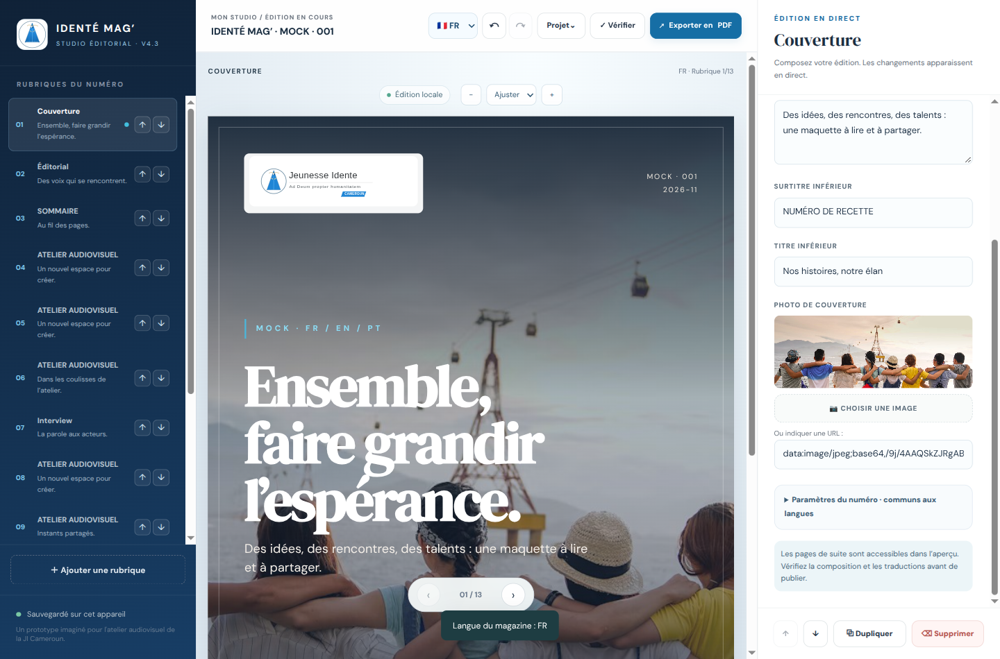
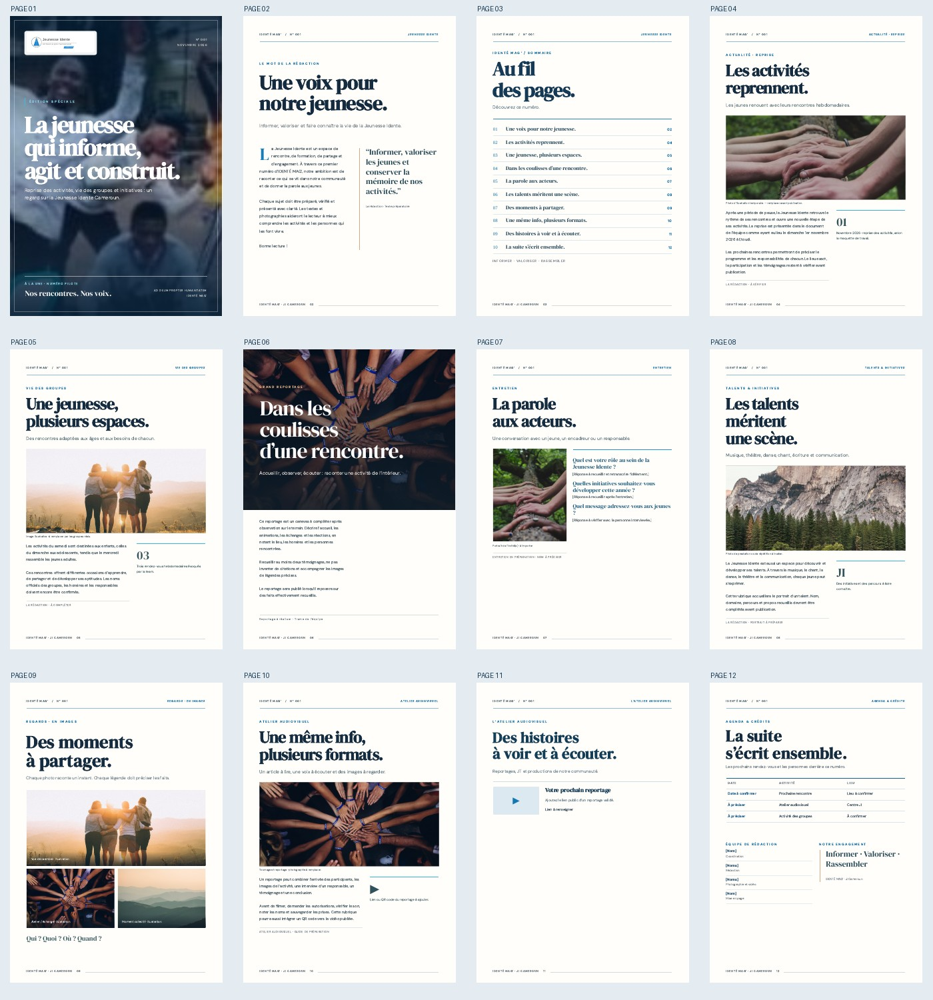

<div align="center">

# IDENTÉ MAG’ Studio

### Du contenu au magazine, avec une identité qui se reconnaît.

Un studio éditorial autonome pour composer des magazines A4 élégants, en **français, anglais et portugais**.


[](https://github.com/arold-takam/idente-mag-studio/actions/workflows/ci.yml)

</div>



## Composer, relire, publier

Pensé pour l’atelier audiovisuel de la **Jeunesse Idente Cameroun**, IDENTÉ MAG’ réunit les contenus, la mise en page et la vérification avant publication dans une même interface.

- **Des maquettes éditoriales** : couverture, éditorial, articles, grand reportage, interview, galerie, médiathèque, agenda et clôture.
- **Une composition cohérente** : pages de suite mesurées, sommaire dynamique et aperçu de toutes les pages physiques.
- **Une édition souple** : réorganisation des rubriques, images importées, listes modifiables et annuler/rétablir.
- **Trois éditions** : FR, EN et PT avec contrôle des traductions manquantes.
- **Un projet portable** : brouillon local, sauvegarde/restauration JSON et ressources de démonstration embarquées.
- **Un export contrôlé** : vérification des compositions et des images avant impression PDF A4.



## Utilisation

Ouvrir `public/index.html` dans **Chrome ou Chromium**. Aucun serveur ni compte utilisateur n’est nécessaire pour travailler localement.

1. Composer les rubriques et importer les photos.
2. Choisir la langue du magazine et parcourir ses pages.
3. Utiliser **Vérifier**, puis exporter en PDF **A4, sans marges, avec les arrière-plans**.
4. Télécharger le projet JSON depuis **Projet** pour conserver une sauvegarde indépendante du navigateur.

**Annuler / Rétablir** : `Ctrl/Cmd+Z`, `Ctrl/Cmd+Maj+Z` ou `Ctrl+Y`. Jusqu’à 40 actions sont conservées dans la session.

Les polices et photos de démonstration sont embarquées. Les médias audio/vidéo et les liens publics nécessitent Internet. Les images distantes peuvent être intégrées avec **Projet → Préparer les images hors ligne**, lorsque leur hébergeur le permet.

## Déploiement sur Netlify

Connecter ce dépôt dans Netlify et sélectionner la branche **`main`**. Le fichier `netlify.toml` définit déjà les paramètres :

| Paramètre | Valeur |
|---|---|
| Commande de build | Aucune |
| Dossier à publier | `public` |

L’application est statique : aucun backend, secret ou variable d’authentification n’est nécessaire pour son déploiement.

## Qualité et développement

La recette locale comprend **16 scénarios**, complétés par des lectures audio/vidéo réelles et des impressions natives FR/EN/PT. Les contenus de démonstration restent des maquettes de travail : la rédaction valide les faits, traductions, crédits et images avant diffusion.

```sh
npm ci
npm run check
npx playwright install chromium
npm test
```

Les tests nécessitent Node.js et `pdftotext` (Poppler). Ils ouvrent Chromium et produisent leurs preuves dans `audit/verification/`. Utiliser `npm run test:ci` pour une exécution sans fenêtre. Le workflow GitHub Actions installe ses dépendances et rejoue la recette.

## Contributions

Les propositions passent par une pull request. Le propriétaire **[@arold-takam](https://github.com/arold-takam)** conserve la décision d’intégration ; la configuration `CODEOWNERS` lui attribue la revue.

Les marques, photographies et polices conservent leurs crédits respectifs. Les licences des polices embarquées figurent dans le HTML.
